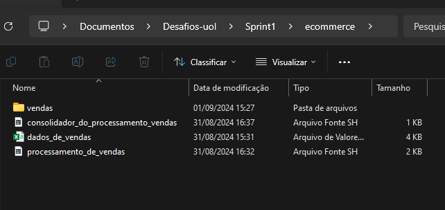
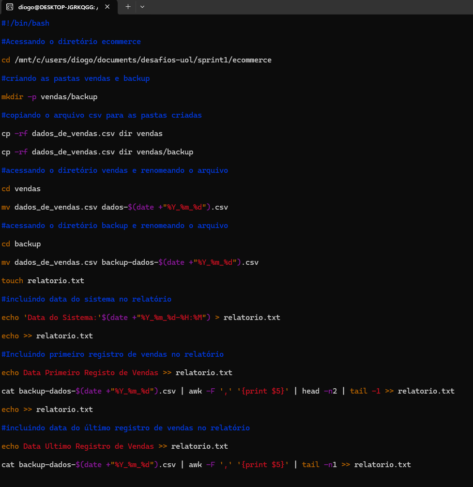
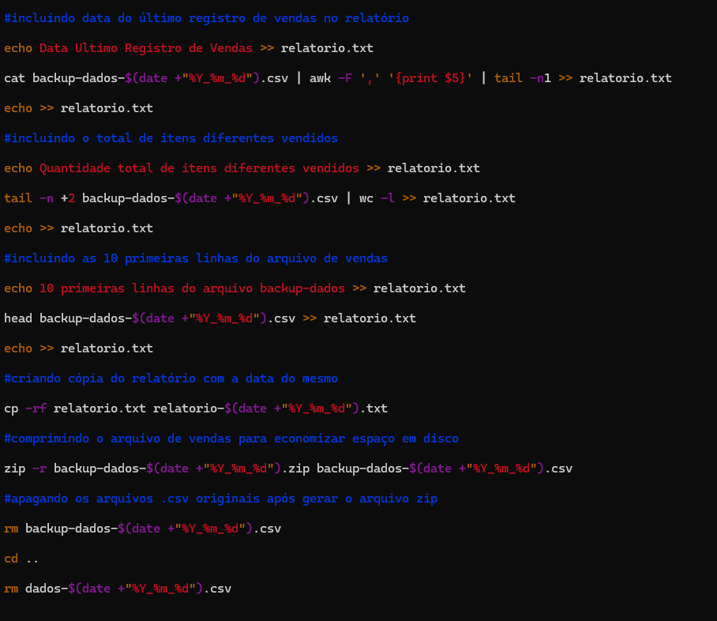
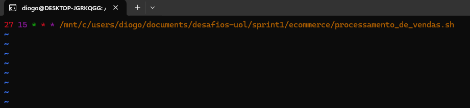
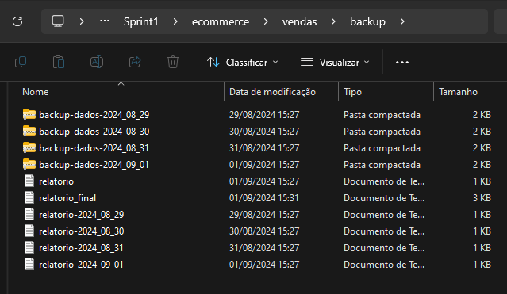

<h2>Proposta Desafio</h2>

O desafio propõe que seja criado um script executável (.sh) para que alguns processos sejam realizados de forma automatizada e sequêncial na planilha que contém os registros de venda.

 
 

<h2>Metodologia</h2>

A metodologia utilizada para criar o script, foi atráves de comandos no terminal do Linux, visto que aprender a trabalhar com ele era um dos objetivos da sprint

 

<h2>Execução</h2>

Inicialmente foi feita a preparação e criada a pasta ecommerce com o arquivo "dados_de_vendas.csv" dentro desta pasta, então à partir disso foi iniciado o desenvolvimento do script processamento_de_vendas.sh,  
o print da pasta foi tirado ao final das execuções, por isso os scripts já estão criados. 

  

Para trabalhar no terminal linux, utilizei o WSL rodando a versão 20.04.6 do Ubuntu. Dentro do editor vim, o script foi escrito conforme as imagens a seguir com os respectivos comentários em cada passagem do script

 
  

Resumindo, o script cria as pastas vendas e backup, processa o arquivo "dados_de_vendas.csv" e o renomeia, gera um relatório .txt com as informações que foram solicitadas no desafio, e depois compacta o novo arquivo.csv  
para economizar espaço e depois apaga o original.

Para esta atividade, foram solicitados coletar dados de 4 dias diferentes, deixando agendado no terminal para executar o script de maneira automática em um determinado horário, isto foi feito utilizando o comando crontab, conforme imagem abaixo:

  

Pode-se notar que neste agendamento eu especifiquei apenas o horário para executar o script, poderia ser mais específico colocando os dias do mês para a execução, ou ainda restringir aos dias da semana, de forma que ainda completasse as 4 execuções. 
A pasta backups no último dia ficou da seguinte forma:

  

Notem que o relatório final já está incluso, este gerado pelo script "consolidador_de_vendas.sh", executado manualmente e que está com o código detalhado a seguir, mas em resumo foi uma concatenação dos relatórios .txt em um único arquivo 

  

<h2>Considerações Finais</h2>

A maior dificuldade do desafio em si, é terminar o script e garantir que o agendamento está funcionando a tempo de rodar os 4 dias que são solicitados. 
As ferramentas para execução são bem simples, bastando o terminal do linux, seja via WSL, ou instalação do sistema Linux dde forma integral. 
Os comentários no script foram feitos após a sua criação para facilitar o entendimento de cada passagem, fazendo com que seja fácil identificar alguma  seção específica que se queira modificar ou apagar em caso de modificações serem necessárias 