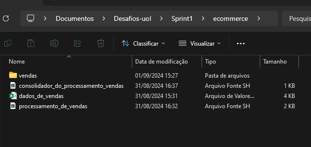
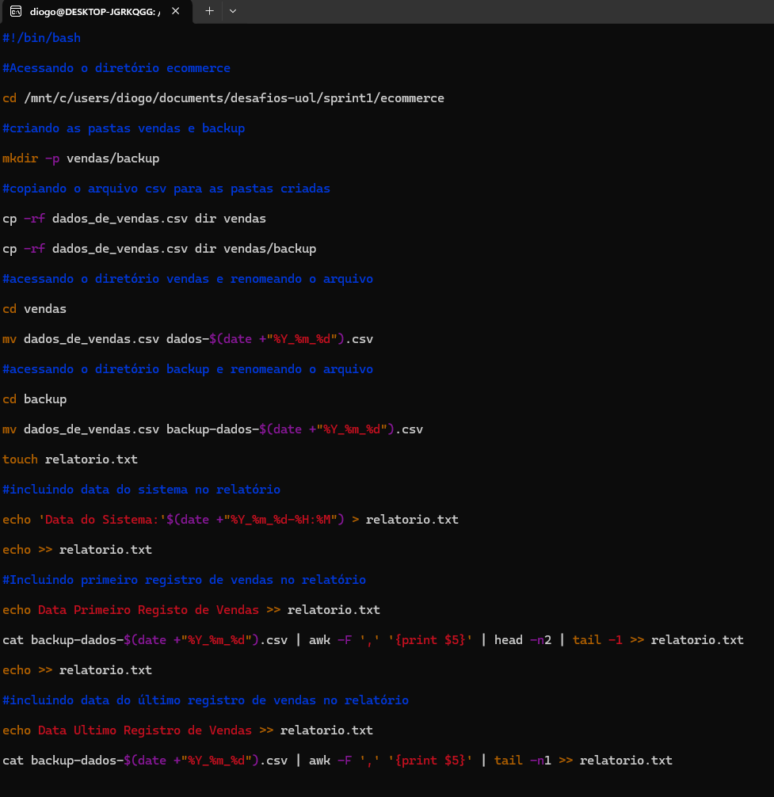
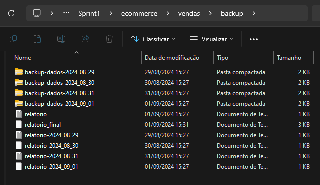

<h2>Exercícios</h2>

Está Sprint não teve exercícios, então o foco dela foi assistir as aulas para poder realizar o desafio 
Os códigos e demais informações e dados pertinentes à sua execução estão disponíveis no <a href="https://github.com/Diloko/PB-Diogo-Ramos/blob/main/Sprint%201/Desafio/README.md">README</a> do desafio.
  

<h2>Evidências</h2>

Neste tópico irei anexar algumas das imagens que mostram o código e as pastas onde o desafio foi realizado

 

Pasta Ecommerce

 
 

Script Processamento Vendas

 

Pasta backup ao final das execuções dos scripts

 

Para mais detalhes sobre o desafio, acesse o <a href src="https://github.com/Diloko/PB-Diogo-Ramos/blob/main/Sprint%201/Desafio/README.md">README</a> do desafio

<h2>Considerações Finais</h2>

A Sprint em si foi bem desafiadora, por ser a primeira, e por abordar trabalhar em um sistema que, no dia a dia,  acredito ser pouco usual para a maioria, inclusive para mim. 
Como não havia exercícios diretos para serem entregues, o meu modo de estudar era realizar as atividades propostas  nas aulas dos cursos durante as explicações e procurar, posteriormente, algum conteúdo complementar sobre o que não ficava claro, 
mas foi gratificante ver o script em si rodando e executando tudo corretamente. 
