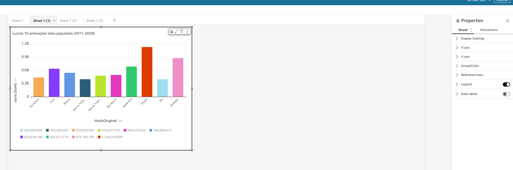
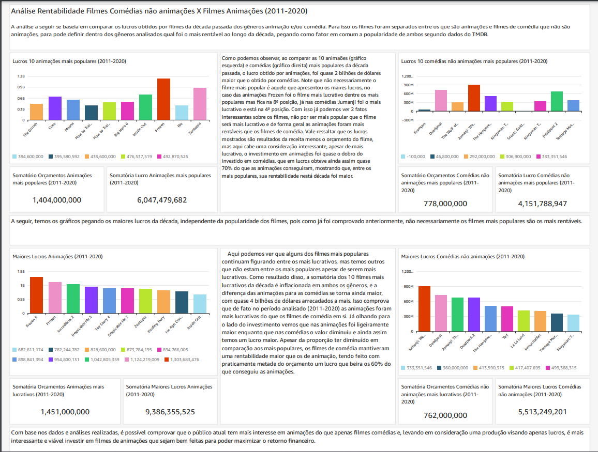

<h2>Proposta Desafio</h2>

O desafio propõe que os dados coletados e tratados anteriormente sejam apresentados em um dashboard.

 
 

<h2>Metodologia</h2>

Para este desafio foi utilizado o AWS Quicksight para a criação de um dashboard com os dados coletados anteriormente. 
Nele foram dispostos gráficos e textos com os dados, para explicar a análise feita e facilitar a sua visualização.

 

<h2>Execução</h2>

<h3>Modelagem Dimensional</h3>

A modelagem que não foi feita seguindo o esquema lógico está corrigida nesta sprint 

<h3>Criação do dashboard</h3>

Após conferir as querys que seriam utilizadas na criação dos datasets, comecei inserindo o primeiro gráfico e o configurando pra testar as opções da ferramenta 

Definidos a forma como iria dispor os dados no dashboard, fui adicionando textos e outras informações para complementar o dashboard 
 

Dashboard completo com as informações referentes à analise: 
 

  

Após feitas as análises e disposições no dashboard, é possível comprovar que nem sempre os filmes mais populares são os mais lucrativos, e também que de forma geral,  
apesar das animações serem mais lucrativas, o investimento necessário para isso é significamente maior, tornando os filmes de comédia, mais rentáveis proporcinalmente às animações. 

<h2>Considerações Finais</h2>

Gostei muito de trabalhar com o quicksigk, achei uma ferramenta interessante, porém o fato de ter que apresentar o dashboard em uma única tela, fez com que não fosse possível  
executar uma análise mais abrangente e completa, pois seria necessário mais espaço e mais gráficos para trazer a tona novas informações para complementar a análise, dito isso,  
por hora estou satisfeito com a análise realizada e acredito que consegui respoder a minha pergunta inicial e mais importante, que era qual dos dois gêneros seria mais rentável, 
fazendo a separação entre animações e comédias que não fossem animações.