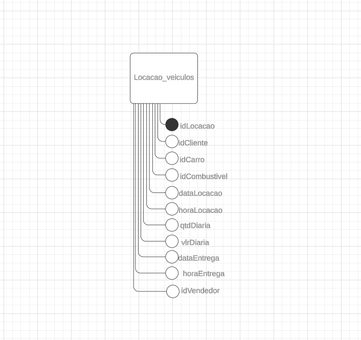
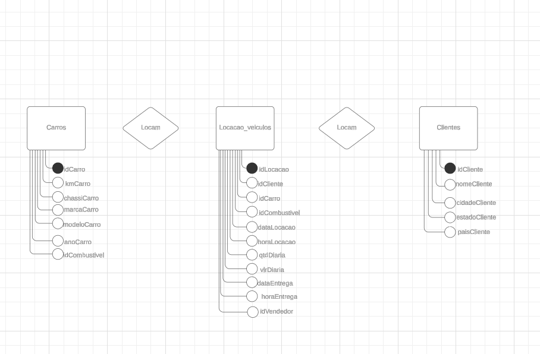
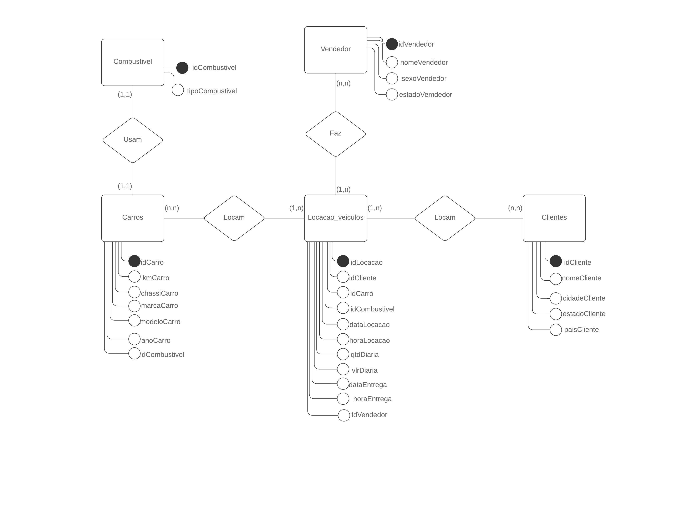
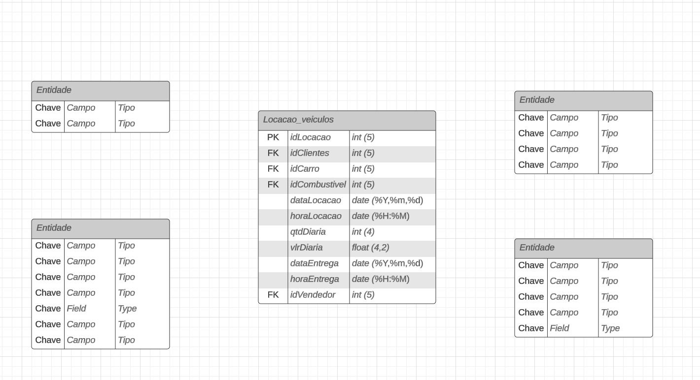
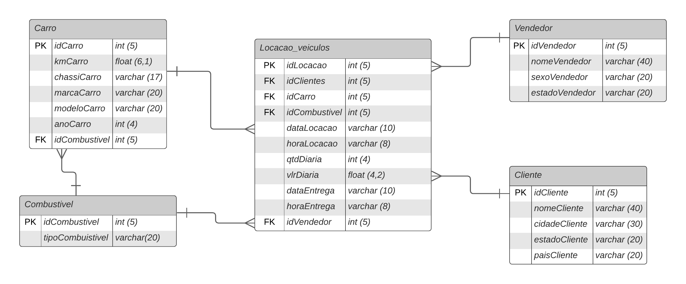
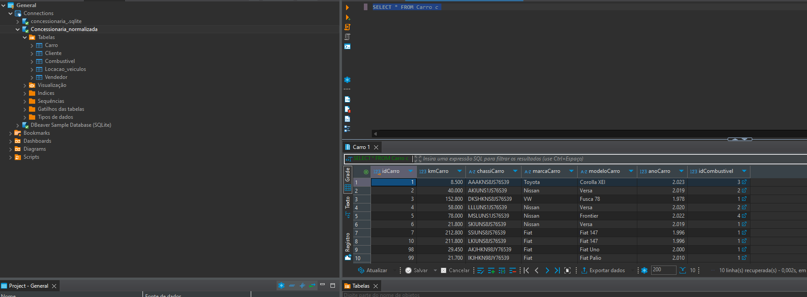
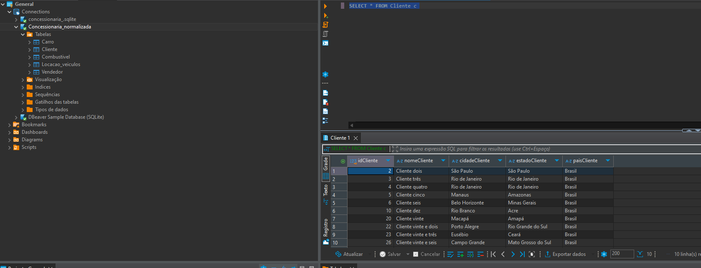
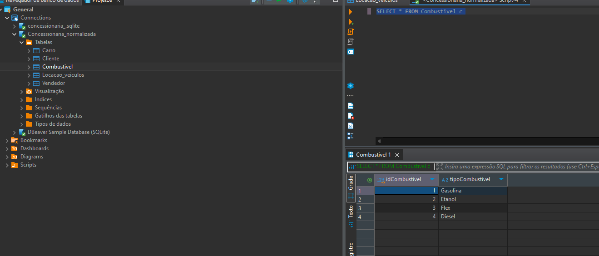
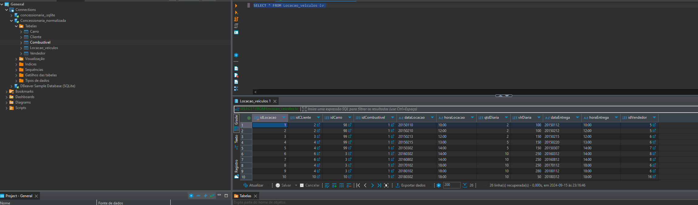
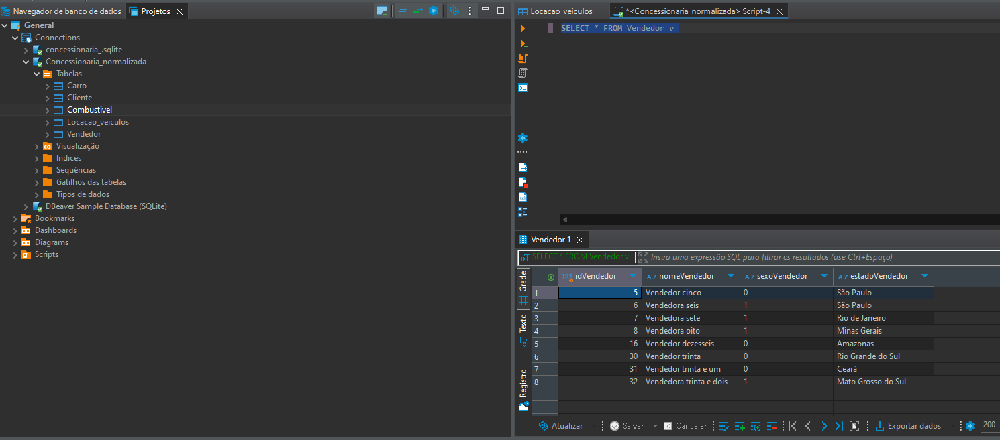

<h2>Proposta Desafio</h2>

O desafio propõe que seja normalizado os dados recebidos sobre uma locadorira de veículos e seja desenvolvida a modelagem Relacional e Dimensional

 
 

<h2>Metodologia</h2>

A metodologia utilizada foi aplicar as formas normais na tabela existente com o auxílio das views que estão presentes na pasta evidências.  
Após criar o modelo relacional, o mesmo serviu de base para a execução do modelo dimensional que posteriormente foi a base para a construção das novas tabelas.

 

<h2>Execução</h2>

Inicialmente foi feita a preparação com as views conforme citado e a partir delas foi feito o diagrama relacional, conforme as imagens abaixo: 

 
 
  

Após isso foi dado início ao modelo dimensional como pode ser conferido abaixo:

 
  

Para seguir as formas normais eu procurei agrupar os grupos de acordo com as informações que estavam disponíveis, agrupando principalmente com os id's que estavam mostrados para montar cada tabela posteriormente.

Após criar as tabelas e inserir os dados, segue os prints dos respectivos select's de cada uma 

 
 
 
 
  

<h2>Considerações Finais</h2>

Eu tive bastante dificuldade de lidar com a normalização dos itens e criação das tabelas, pois é algo que não estou acostumado 
Por fim, após testar o Dbeaver, consegui ter mais facilidade para criar as tabelas e copiar os dados existentes da antiga, após ter inserido os primeiros manualmente  
COloquei junto nas evidências os exports que fiz para os dados, tendo apenas que alterar a tabela destino no topo. 