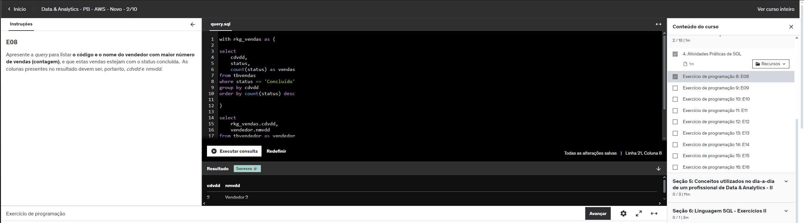
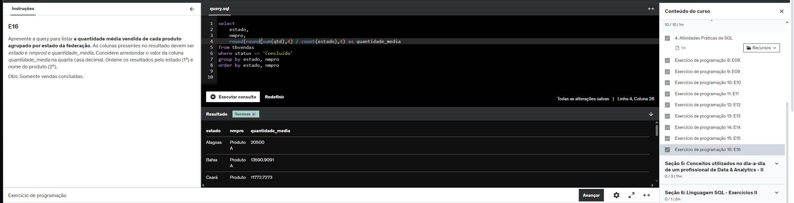
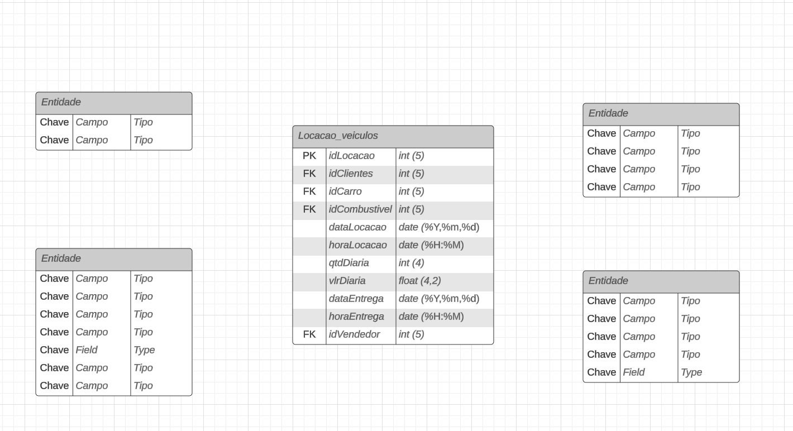

<h2>Exercícios</h2>

Está Sprint teve alguns exercícios que foram bem desafiadores, principalmente por ser um tema que não tive ainda muita prática com o assunto. 
Dentro da pasta de exercícios tem a resposta para cada atividade dentro da Udemy, juntamente com a mensagem de que o resultado obtido foi de acordo com o esperado na plataforma.
  

<h2>Evidências</h2>

Neste tópico irei anexar algumas imagem de alguns exercícios resolvidos, bem como o início da modelagem do BD.

 

Exercício 08

 
 

Exercício 16

 
 

Início Modelagem Relacional

 

PInício Modelagem Dimensional

 

<h2>Considerações Finais</h2>

Trabalhar com SQL é de extrema importância no cenário de dados, mesmo que não for sua principal atividade,  é importante saber ler, interpretar e puxar o básico dos dados quando solicitado. 
Os exercícios aprofundaram muito a teoria passada durante o curso, e foram uma ferramenta importante para compreender melhor o uso das querys.  
O curso da AWS dá uma introdução sobre o que é a empresa e como ela atua no mercado, não tem de fato nenhum conteúdo prático ainda,  
então estou ansioso pelos próximos para poder colocar em prática os valores colocados da empresa.
 