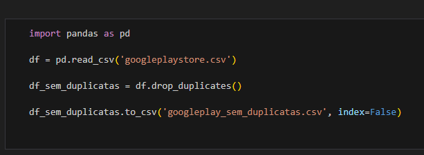
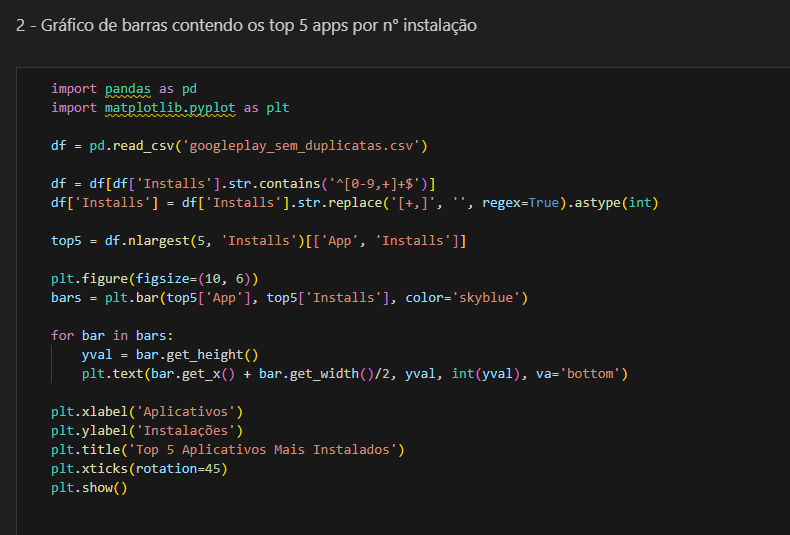
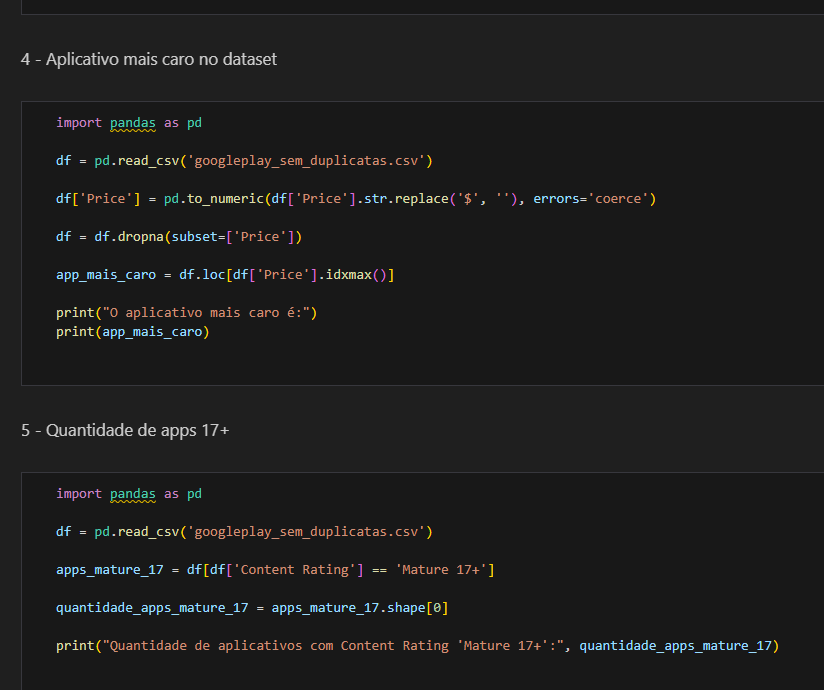

<h2>Proposta Desafio</h2>

O desafio propõe que sejam extraídos dados e gerados gráficos de um dataset, utilizando as bibliotecas pandas e matplotlib.

 
 

<h2>Metodologia</h2>

A metodologia utilizada foi inicialmente eliminar as duplicatas que pudessem existir na tabela (era também o primeiro item pedido) para depois seguir com as extrações.  
Foram criados os códigos propostos pra cada item e os resultados obtidos verificados dentro do possível se faziam sentido, dado o tamanho do dataset não dá pra verificar manualmente.

 

<h2>Execução</h2>

Inicialmente foi a remoção das duplicatas, conforme print do código abaixo: 

  

Após isso foi dado início às extrações como pode ser conferido abaixo:

 
  

Os dados podem ser conferidos executando cada cédula do notebok do Desafio. 

<h2>Considerações Finais</h2>

Eu tive bastante dificuldade de lidar com as bibliotecas, pois é algo que não foi abordado no curso em si, tendo que recorrer a internet para buscar o conteúdo. 
Gostei da parte dos conceitos e configuração do ambiente, é bem didático para quem não tem muito contato com python dessa forma (só havia utilizado o collab na faculdade)  
Apesar de não ter muitos prints nas evidências, achei mais fácil colocar os códigos compilados dessa vez para ter acesso mais fácil do que apenas imagens. 