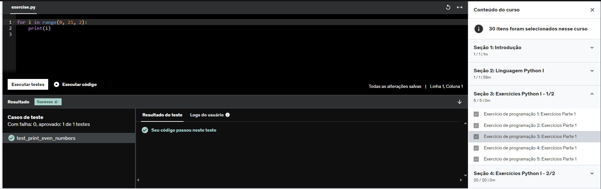
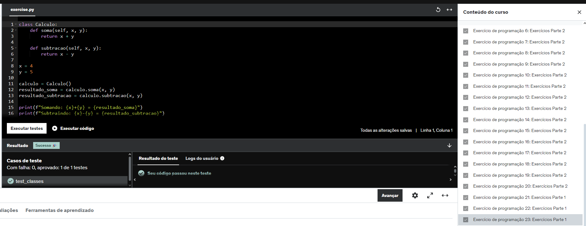
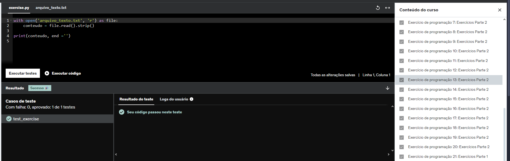

<h2>Exercícios</h2>

Está Sprint foi um misto entre alguns exercícios muito fáceis e outros bem desafiadores 
Dentro da pasta de exercícios tem um notebook do python com os códigos de todos os exercícios, juntamente dois prints de que os exercícios foram resolvidos dentro da plataforma com sucesso.
  

<h2>Evidências</h2>

Neste tópico irei anexar algumas imagem de alguns exercícios resolvidos, os códigos completos dos 25 exercícios e da etl estão na pasta exercícios.

 

Exercício 08

 
 

Exercício 16

 
 

 
 

<h2>Considerações Finais</h2>

Essa sprint teve um curso de python que em alguns momentos foi confuso, o conteúdo era bastante denso e nem sempre estava na melhor ordem possível. 
Os exercícios ajudaram a esclarecer alguns conceitos que com os exemplos não estavam tão claros e a etl sem usar bibliotecas, evidênciou  
a diferença que elas fazem quando o arquivo é grande como no caso do desafio. O curso da AWS focou nos custos da plataforma, sendo bem esclarecedor.  
De forma geral foi uma sprint que fluiu ok, mas percebi, ao final dela, que prefiro as querys do sql do que ficar codando em python.
 