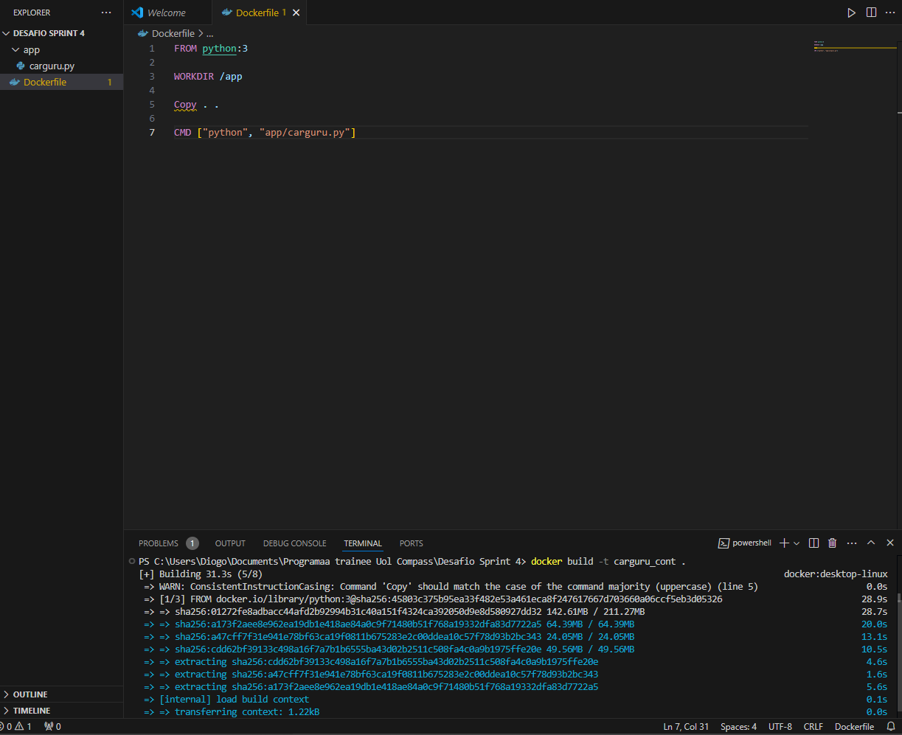
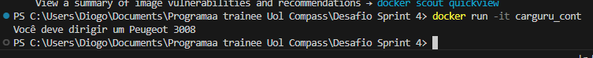
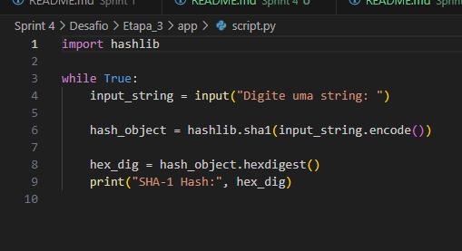
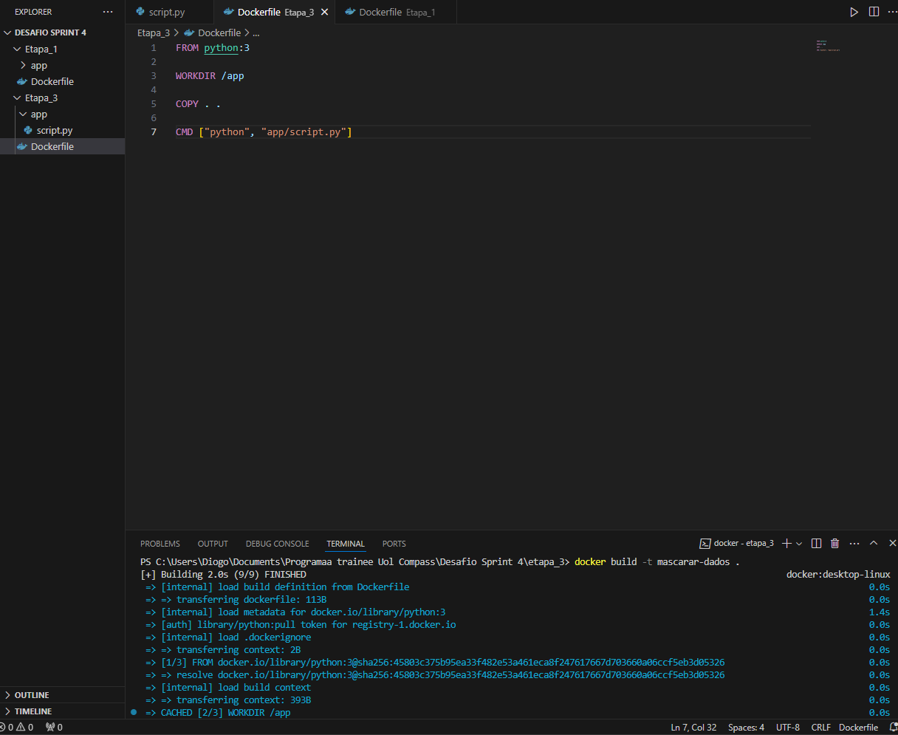
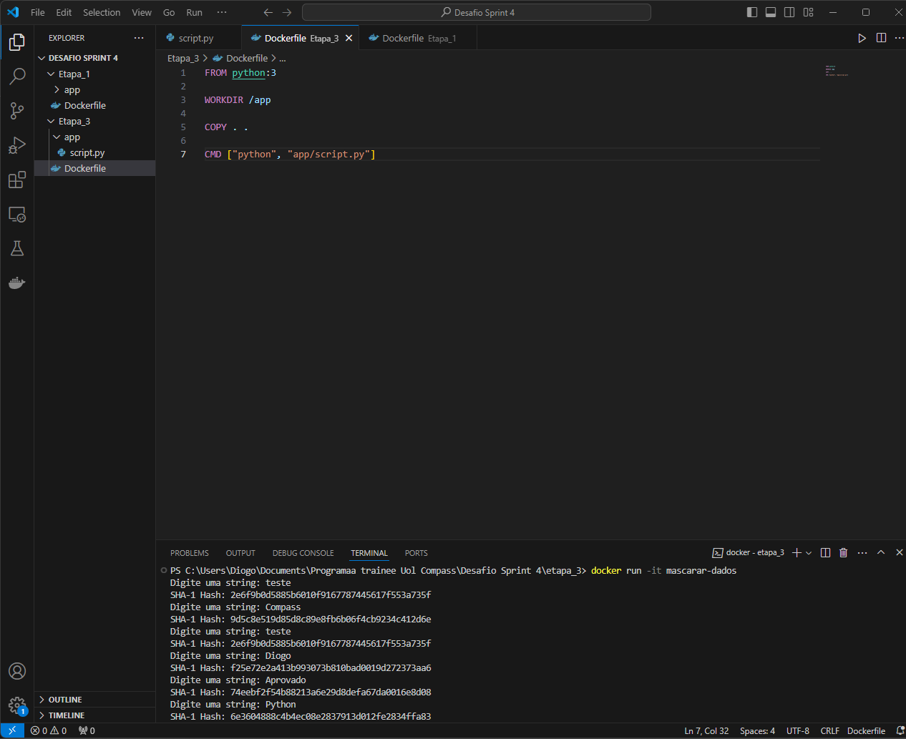

<h2>Proposta Desafio</h2>

O desafio propõe que sejam criados dois containers para execução de dois scripts em python, um previamente fornecido e outro feito por nós.

 
 

<h2>Metodologia</h2>

A metodologia utilizada foi inicialmente verificar a execução dos scripts em python para saber o resultado esperado e em seguida, montar os containers.  
Estes foram criados em seguida testados, como poderemos ver nas imagens.

 

<h2>Execução</h2>

<h3>Etapa 1</h3>

Como na etapa um o script carguru.py já havia sido fornecido, foquei em desenvolver o container e confirmar sua execução, segue abaixo a sua criação e execução: 

  

  

<h3>Etapa 2</h3>

Nesta etapa nos foi questionado se um container pode ser reutilizado, e a resposta para isso é sim.  De forma geral ele pode ser pausado e despausado, ou então parado e iniciado novamente, seguem os códigos para isso:

<pre>docker pause nome-do-container (pausa o container)
docker unpause nome-do-container (despausa o container)

docker stop nome-do-container (para o container)
docker start nome-do-container (inicia o container novamente)</pre>

<h3>Etapa 3</h3>

 Na etapa 3 foi pedido para criar um script em python que mascarasse palavras e depois um container para roda-lo, seguem as imagens da criação do script, imagem do container e da execução:

  

  

  

<h2>Considerações Finais</h2>

Essa sprint de forma geral achei um mais leve do que as outras, o desafio foi relativamente simples. 
Os exercícios e desafio de forma geral tiveram códigos mais curtos, e acredito que o foco foi nos dar uma  
introdução do que é docker e suas aplicações. 