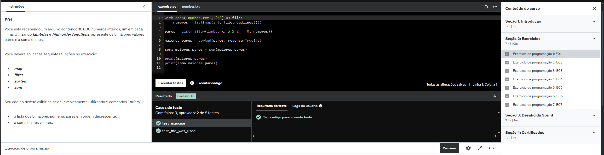
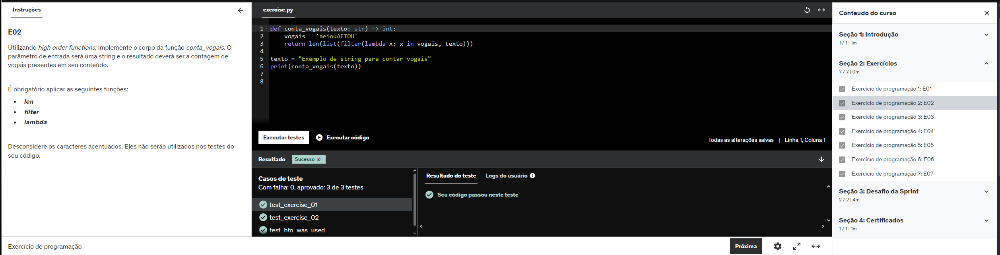

<h2>Certificados</h2>

Nessa sprint foram obtidos dois certificados da AWS, que se encontram na pastas do link abaixo
  

<a href="https://github.com/Diloko/PB-Diogo-Ramos/tree/main/Sprint%201">Sprint 1</a> 

<h2>Exercícios</h2>

Está Sprint de forma geral os exercícios foram mais tranquilos, a dificuldade foi ajustar o output para  
ficar exatamente como a Udemy esperava. Dentro da pasta de exercícios tem os prints com as resoluções de cada exercício da sprint.
  

<a href="https://github.com/Diloko/PB-Diogo-Ramos/tree/main/Sprint%201">Sprint 1</a> 

<h2>Evidências</h2>

Neste tópico irei anexar algumas imagem de alguns exercícios resolvidos, juntamente com o link para acessar a pasta.

 

Exercício 01

 
 

Exercício 06

 
 

<h2>Considerações Finais</h2>

Essa sprint teve uma continuação do curso de python (um módulo) e o curso de dockers, particularmente  
gostei das funções do docker e da facilidade que ele proporciona para execução das imagens. Os cursos da AWS   trambém nos passam muitas informações dos serviços deles, o que é interessante, ainda mais que agora   iremos começar a trabalhar na plataforma deles
 