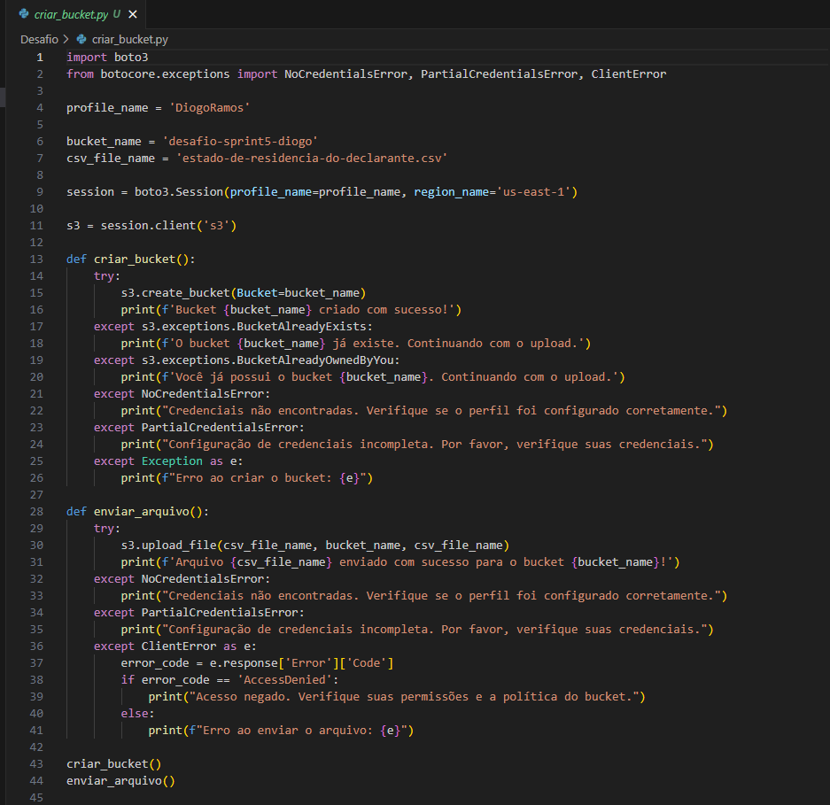
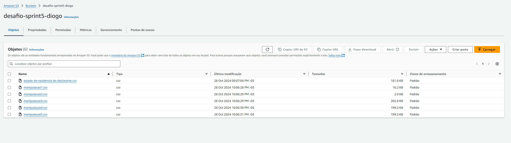

<h2>Proposta Desafio</h2>

O desafio propõe que seja criado um bucket a partir do python e sejam feitas análises em um arquivo csv.

 
 

<h2>Metodologia</h2>

A metodologia utilizada foi inicialmente verificar o arquivo csv para ver as possíveis análises que poderiam ser feitas e   depois montar os scripts em python para execução do que era pedido 
Estes foram criados em seguida testados, como poderemos ver nas imagens.

 

<h2>Execução</h2>

<h3>Criação do Bucket</h3>

O Bucket foi criado usando a biblioteca boto3 em python, o código completo pode ser verificado dentro da pasta e na imagem abaixo 

  

<h3>Análise de dados</h3>

Para fazer as análises, abordei criar um novo arquivo csv para cada função executada, para facilitar a visualização do que estava sendo feito

  

  

<h2>Considerações Finais</h2>

Achei o conteúdo do desafio relatiavmente simples, mas a falta de conteúdos sobre as bibliotecas utilizadas me parece desconexo com o que é passado na sprint. A execução apesar de não ser muito complexa, em sua maior parte, tive que buscar fora da Udemy ou dos curso da AWS que são indicados na sprint.