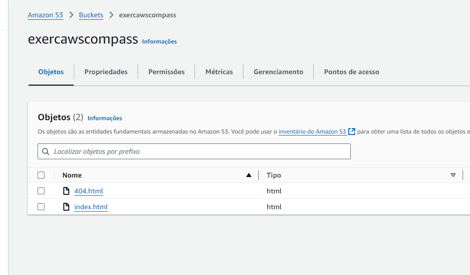
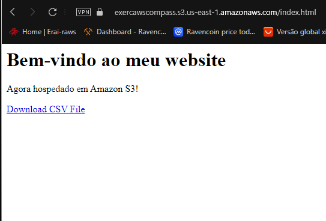

<h2>Certificados</h2>

Nessa sprint foram obtidos um certificado e uma badge da AWS, que se encontram na pastas do link abaixo
  

<a href="https://github.com/Diloko/PB-Diogo-Ramos/tree/main/Sprint%205/Certificados">Certificados</a> 

<a href="https://www.credly.com/badges/daebde93-3c20-41d9-9e5c-2338fbf72771/public_url">Badge Cloud Quest</a>

<h2>Exercícios</h2>

Está Sprint teve apenas um exercício para nos mostrar e introduzir a criação dos buckets no S3. Abaixo tem o link para a pasta com as imagens sobre a sua execução.
  

<a href="https://github.com/Diloko/PB-Diogo-Ramos/tree/main/Sprint%205/Exercícios">Exercícios</a> 

<h2>Evidências</h2>

Neste tópico irei anexar algumas imagem de alguns exercícios resolvidos. O desafio estará detalhado em seu próprio markdown.

 

Objetos upados para o bucket

 
 

Index rodando no Bucket criado como é possivel confirmar pela url

 
 

<h2>Considerações Finais</h2>

Essa sprint foi uma grande introdução ao munda da AWS, gostei bastante do jogo, por ter uma abordagem bem prática.   Em relação ao curso é uma preparação para a prova de certificação que faremos ao final do programa, é um ótimo conteúdo,   mas que provavelmente irei rever quando estiver mais próximo da prova junto com outros

 
