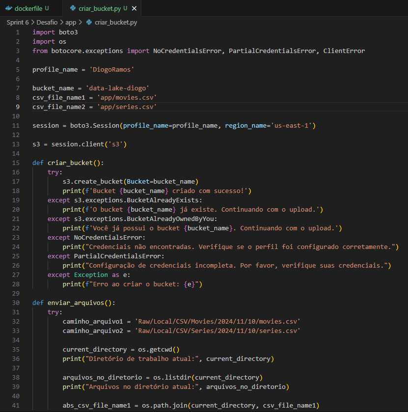
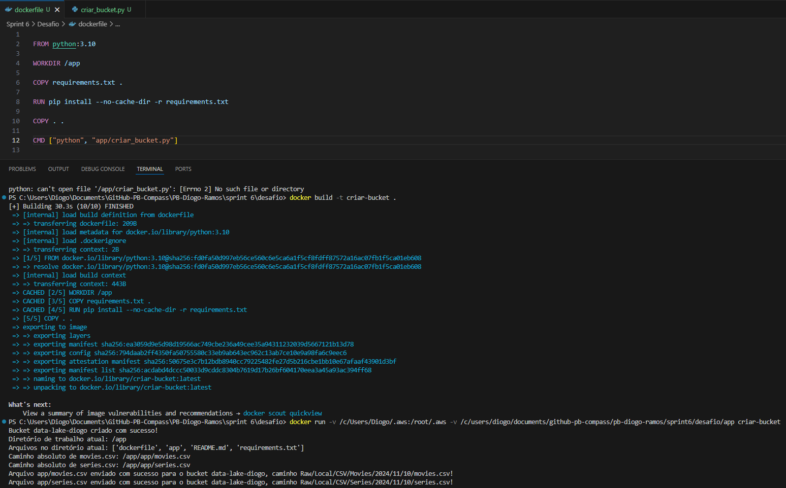
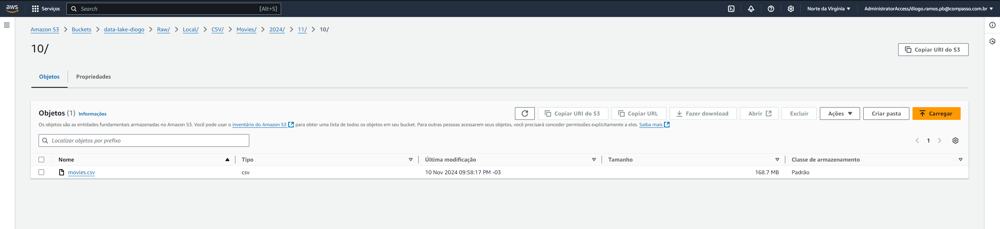

<h2>Proposta Desafio</h2>

O desafio propõe que seja criado um bucket a partir de um script python rodando em um container .

 
 

<h2>Metodologia</h2>

A metodologia utilizada foi inicialmente criar o script python e posteriormente montar o docker 
Estes foram criados em seguida testados, como poderemos ver nas imagens.

 

<h2>Execução</h2>

<h3>Criação do script python</h3>

O script python foi montado como pode ser consultado no código e na imagem a seguir: 

A criação da imagem do docker rodou normalmente, mas tive problemas na hora de executar o container por conta da autenticação via AWS CLI, 
mas foi resolvido utilizando o código que está no print na hora de rodar a imagem 

Como podemos verificar foram além da criação ter sido executada corretamente, foram enviados os arquivos no formato solicitado 

O bucket gerado é arn:aws:s3:::data-lake-diogo, não compreendi totalmente a parte de subir o laboratório s3 do feedback 
OBS.: Os arquivos movies.csv e series.csv foram retirados da pasta app detro do desafio pois são muito grandes para serem enviados para o github

<h2>Análise à ser executada</h2>

Para a análise final do desafio, pretendo ter as respostas para as seguintes perguntas: 

-O que foi mais rentável entre séries e filmes mais populares da última década?; 
-Baseado nos custos é preferível investir em séries ou filmes com o foco principal sendo lucro? 
-Existe relação entre as obras mais populares e os prêmios que a indústria distribui? 

<h2>Considerações Finais</h2>

Gostaria que as API's fossem apresentadas juntamente com os arquivos csv's, pois apesar de ter escolhido um tema que envolve a parte financeira, 
a mesma não se encontra no csv, de forma que não poderia pensar nela antes de serem apresentadas as api's na sprint 7. Felizmente o monitor me ajudou mostrando 
que esses dados, apesar de não serem garantidos para todos os filmes e séries, se fazem presentes nas api's.