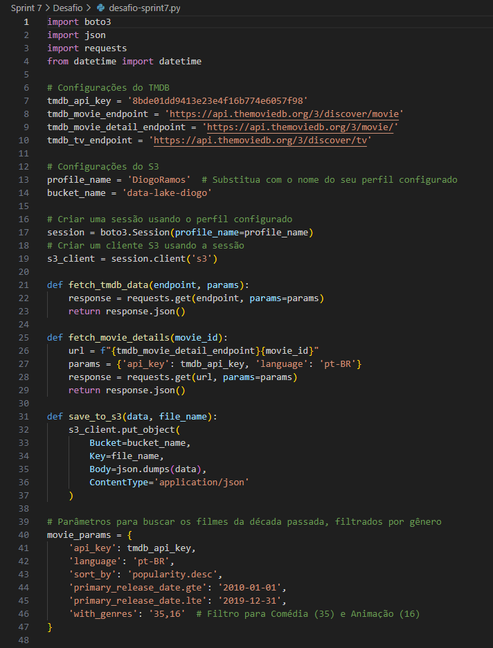
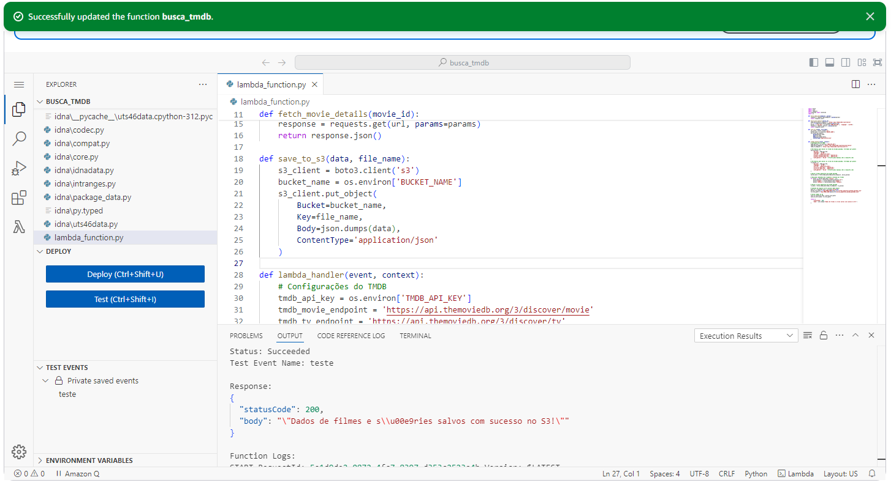
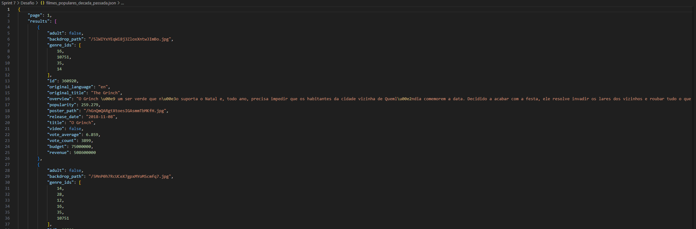

<h2>Proposta Desafio</h2>

O desafio propõe que seja criado uma busca ans apis do tmdb usando o AWS Lambda e depois salve no bucket S3.

 
 

<h2>Metodologia</h2>

A metodologia utilizada foi inicialmente criar o script python de forma local e depois adaptar para o lambda 
Após executar localmente e funcionar subi para o lambda e testei até ele rodar lá também.

 

<h2>Execução</h2>

<h3>Criação do script python</h3>

O script python foi montado como pode ser consultado no código e na imagem a seguir: 

Para criar a função dentro do AWS Lambda, primeiro fiz um zip do script levemente modificado, 
depois fiz uma layer para ele importar corretamente a biblioteca request e defini parâmetros de bucket_name e API_TMDB, 
além de dar as devidas permisões usando o AWS IAM.

Como podemos verificar foram além da criação ter sido executada corretamente, obtive os arquivos json conforme esperado 

O bucket gerado é arn:aws:s3:::data-lake-diogo, segue o mesmo que será trabalhado até o final do programa 
Subi os arquivos jsonno github também, para poder ser melhor analisado caso seja do interesse da equipe técnica.

<h2>Considerações Finais</h2>

Este desafio foi relativamente mais simples do que o anterior, mas gostaria que fosse mais detalhado o tópico das apis, 
que ficou meio que jogado para usarmos e pelo que pude ver será melhor abordado agora na sprint 8.