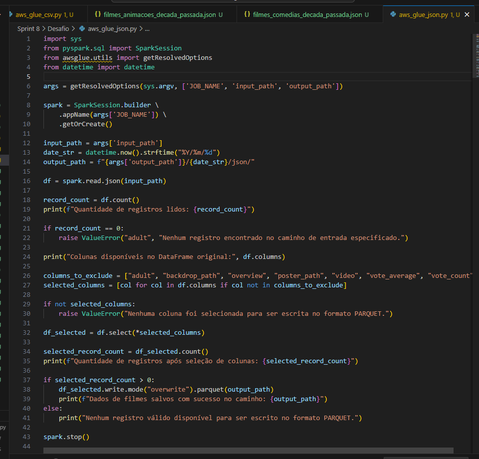
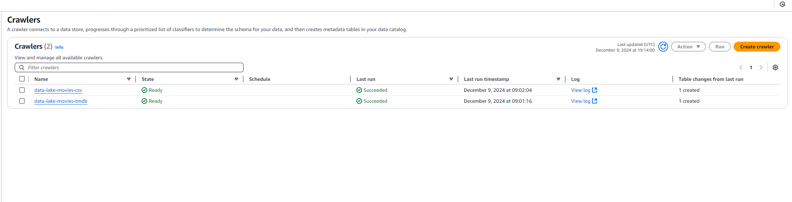
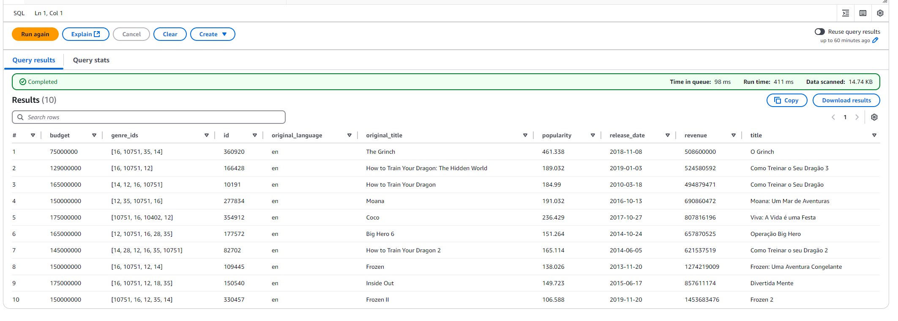
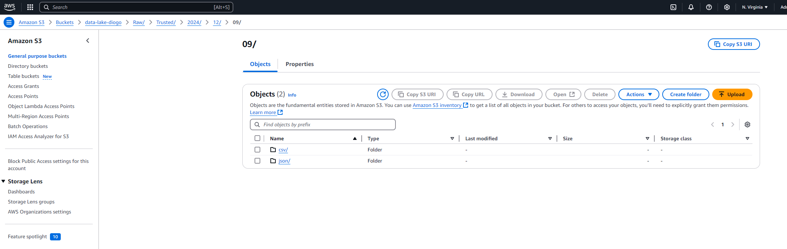

<h2>Proposta Desafio</h2>

O desafio propõe que sejam convertidos os arquivos csv e json para parquet, utilizando o aws glue

 
 

<h2>Metodologia</h2>

A metodologia utilizada foi inicialmente criar o script para o aws glue, e após funcionar com sucesso 
criar os crawler'se fazer a consulta teste no athena

 

<h2>Execução</h2>

<h3>Criação do script python</h3>

O script python foi montado como pode ser consultado no código da pasta e na imagem a seguir: 

Após criar e executar corretamente o job no glue, criei os crawler's e fiz a consulta teste no athena:

Abaixo tem o caminho da pasta trusted criada com o código, separei os parquet do csv e json pois pra mim não estava claro o suficiente o caminho, 
se precisar unificar é simples alterar o caminho para isso:

  

Em relação as perguntas que eu havia proposto responder na sprint 6, percebi que infelizmente não será possível, já que ao puxar os dados financeiros das séries precebi que os mesmos estavam praticamente todos como nulo (esse foi um erro que tinha no script da sprint 7, por isso tem um novo script nessa), de forma que não seria possível fazer uma comparação apropriada igual eu queria inicialmente.  
Por conta disso, em vez de comparar filmes e séries, irei estar alterando para animações e filmes de comédia que não são animações, neste formato, uma animação pode ter comédia como seu gênero também, mas as comédias listadas não possuem o gênero animação.  
Desta forma as perguntas que constam na sprint 6, podem ser redigidas novamente da seguinte forma:  

-O que foi mais rentável entre animaões e comédias mais populares da última década? 
-Baseado nos custos é preferível investir em animações ou filmes de comédia com o foco principal sendo lucro? 
-Existe relação entre a popularidade e a rentabilidade das obras? 
 
E caso seja neessário, podem ser feitas mais análises durante o restante do projeto.

<h2>Considerações Finais</h2>

Este desafio ficou bem mais fácil por conta de termos tido o lab glue na sprint passada, único ponto que realmente fiquei em dúvida foi com relação ao caminho final dos arquivos parquet no trusted, se era pra separar ou não. 
No restante foi um desafio relativamente simples de entender e executar.