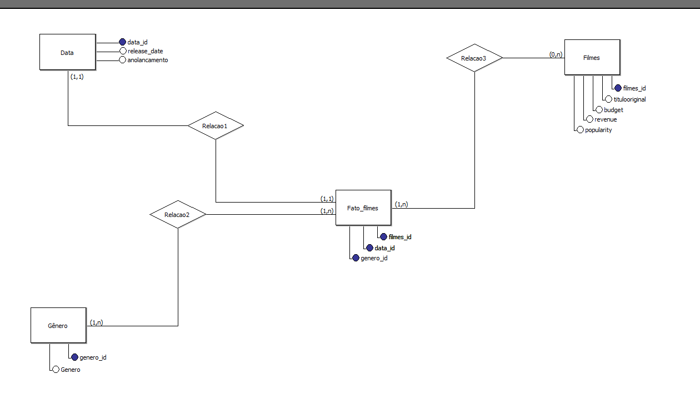
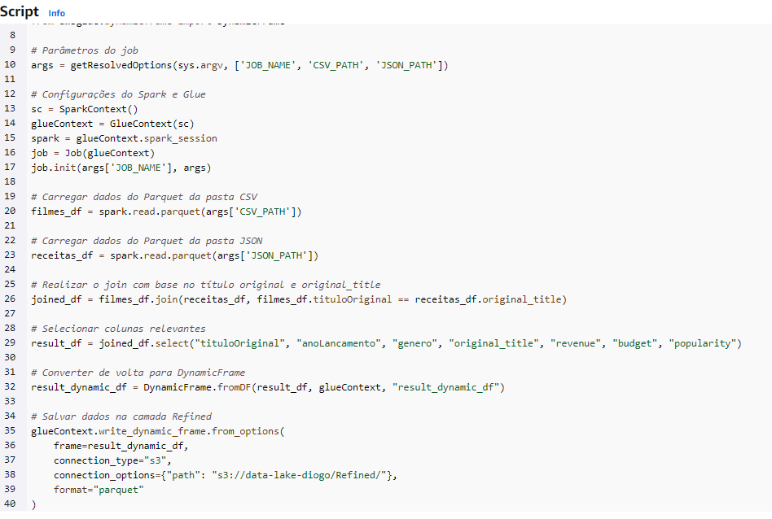
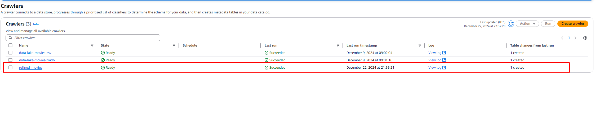
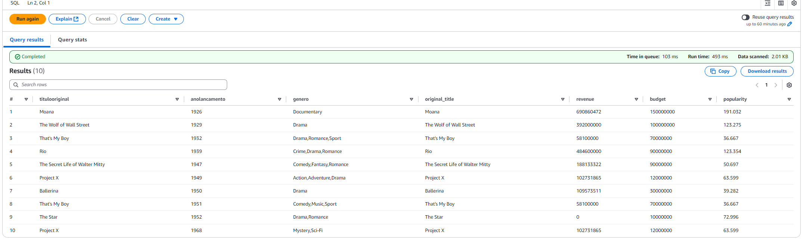
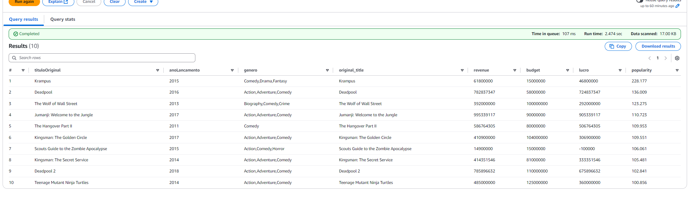
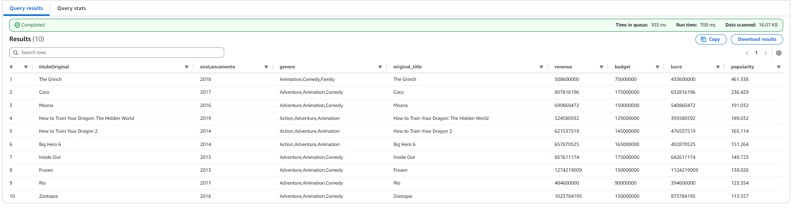
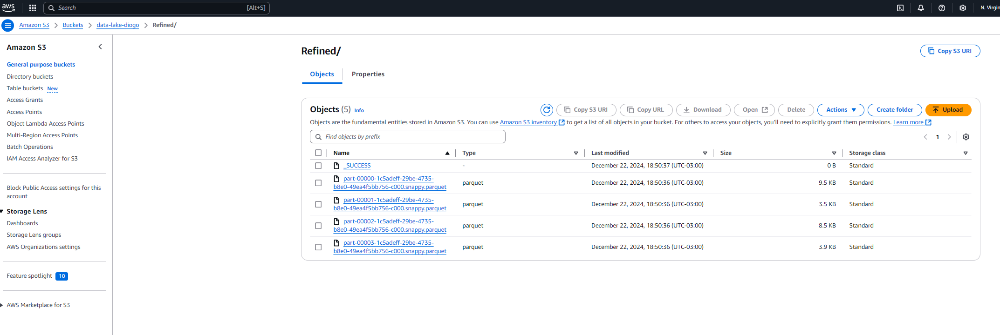

<h2>Proposta Desafio</h2>

O desafio propõe que os dados armazenados na camada trusted sejam refinados para a utilização no quicksight posteriormente.

 
 

<h2>Metodologia</h2>

A metodologia utilizada foi semelhante a da sprint passada, criar o script para o aws glue, e após funcionar com sucesso 
criar o crawler e fazer a consulta teste no athena juntamente com outros filtros, com a diferença que foi feita uma modelagem ed dados antes

 

<h2>Execução</h2>

<h3>Modelagem feita no ModeloBR</h3>

A modelagem pode ser vista tanto no print abaixo quanto no código dela na pasta do desafio 

<h3>Criação do script python</h3>

O script python foi montado como pode ser consultado no código da pasta e na imagem a seguir: 

Após criar e executar corretamente o job no glue, criei os crawler's e fiz a consulta teste no athena: 

 

Teste filtragem comédias não animação da década passada (2011-2020):
 

Teste filtragem animação da década passada (2011-2020):
 

Abaixo tem o caminho da pasta trusted criada com o código: 
 

  

O foco da análise segue sendo responder as perguntas colocadas na sprint passada, fazendo uma comparação direta entre filmes de comédia que não são animações e animações independente dos sub-gêneros, com foco na parte financeira dos mesmos.

<h2>Considerações Finais</h2>

O desafio em si me lembrou bastante o da sprint passada, mas com a modelagem de dados a ser feita para definir o que seria enviado de fato para a camada refined. De forma geral gostei muito que é onde você vê de fato 
os dados que você está trazendo para a análise antes de montar o quicksight.